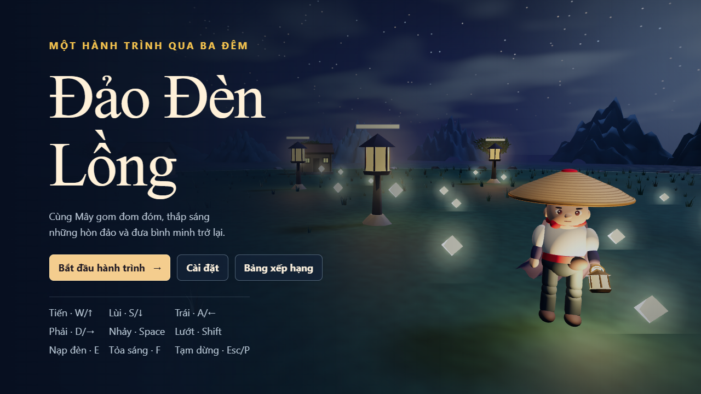

# Đảo Đèn Lồng

[Video demo](docs/demo/demo.mp4) · [Bản phát hành v1.0.0](https://github.com/BaoAIuet/K5-L3A-LAB-Day12-HoangVanBao-2A202603549-AI-SDLC/releases/tag/v1.0.0)

Game 3D góc nhìn thứ ba về Mây, người giữ đèn nhỏ tuổi thu thập đom đóm, thắp lại đèn và né Bóng Mực.



## Yêu cầu hệ thống

Node.js 22 trở lên trên Windows, macOS hoặc Linux. Trình duyệt cần WebGL 2. Benchmark tự tìm Chrome/Chromium và hỗ trợ `BENCH_BROWSER` để chỉ định đường dẫn.

## Cài đặt và chạy

```bash
npm ci
npm run build
npm start
```

Mở `http://localhost:4173`.

## Điều khiển

- `WASD` hoặc mũi tên: di chuyển.
- `Space`: nhảy; `Shift`: lướt.
- `E`: nạp đom đóm vào đèn gần.
- `F`: tỏa sáng, làm choáng Bóng Mực và xua Gió Lạc.
- `Esc` hoặc `P`: tạm dừng; kéo chuột: xoay camera.
- `R`: chơi lại màn đã kết thúc.
- Cài đặt cho phép đổi từng phím, bật bảng màu dễ phân biệt, tăng cỡ chữ và giảm chuyển động.

## Điểm số

- Mỗi đom đóm nạp: 5 điểm. Thắp lần đầu 100 điểm, thắp lại 40.
- Tỏa Sáng trúng Bóng Mực được 5 điểm, hoặc 15 nếu nó đang hút dầu.
- Khi thắng, mỗi đèn sáng cho 50 cộng số dầu nguyên. Mỗi Ngọn Lửa còn lại cho 50.
- Giữ ít nhất 3/5, 4/6 hoặc 5/7 đèn sáng đến bình minh. Châm dầu bằng phím tương tác. Đèn yếu dưới 30 dầu mất vùng an toàn.

## Chế độ headless

```bash
npm test
node src/headless.js --seed 42 --night 1 --ticks 360 --out sample.jsonl
```

`--night` nhận 1, 2 hoặc 3; JSONL có snapshot tick/sim_tick và các entity đang hoạt động. Input/scenario truyền bằng `--inputs` hoặc `--scenario`. Logic headless không phụ thuộc GPU.

## Đo hiệu năng và xuất điểm

```bash
node src/bench.js --seed 42 --duration 30 --out bench.json
node --expose-gc --max-semi-space-size=1 src/soak.js --seed 7 --nights 10 --out soak.json
node src/server.js --export-leaderboard leaderboard-export.json
```

Benchmark mở cửa sổ Chrome với vùng vẽ 1280 × 720. `BENCH_HEADLESS=1` dành cho môi trường không có màn hình. Chrome được yêu cầu bỏ giới hạn khung hình, nhưng trang web không xác nhận được trạng thái VSync thực tế, nên báo `vsync_off: false`. RSS của tiến trình kết xuất tách riêng nên `peak_mem_mb` là `null`. Bảng xếp hạng lưu ở `data/leaderboard.json`. Có thể đổi vị trí qua biến `LEADERBOARD_FILE`.

## Bản đóng gói

Bản ZIP chứa máy chủ và thư viện kết xuất. Giải nén, chạy `node src/server.js` rồi mở `http://localhost:4173`.
Thư mục `web/` bên trong ZIP có thể được phục vụ ở gốc của một máy chủ web tĩnh. Bản tĩnh dùng bộ nhớ cục bộ của trình duyệt cho bảng điểm. Chạy máy chủ Node.js để sử dụng bảng điểm trên đĩa và lệnh xuất CLI.
Repo cũng có Dockerfile. Chạy `docker build -t dao-den-long .` rồi `docker run --rm -p 4173:4173 -v dao-den-long-data:/app/data dao-den-long`.

## Cấu trúc

- `src/game.js`: logic gameplay độc lập phần hiển thị, 3 đêm.
- `src/headless.js`: CLI theo Test Contract.
- `public/`: giao diện game 3D Three.js và HUD.
- `tests/`: test unit và kiểm tra tính tất định.
- `docs/notes/`: giả định, nhật ký AI, retro.
- `docs/proof/`: bằng chứng kiểm chứng từng phase.

## Các phase

Tag `phase-1` là bản một đêm với Test Contract v1.0. Tag `phase-2` là bản ba đêm với Test Contract v1.1. Xem [spec Phase 2](docs/notes/phase-2-spec.md) và [bằng chứng kiểm chứng](docs/proof/phase-2/README.md).

Tag `phase-3` bổ sung dầu đèn và điều kiện bình minh trong [Contract v1.2](docs/proof/phase-3/README.md).
Tag `phase-4` hoàn tất [Contract v1.3 và kiểm chứng phát hành](docs/proof/phase-4/README.md).

## Sáng tạo của tôi

Thế giới Three.js có mặt nước chuyển động, quầng sáng cho đom đóm và vòng sáng khi thắp đèn. Phần hiển thị đọc dữ liệu từ mô phỏng; các bài test xác nhận kết quả headless lặp lại với cùng seed và input.
